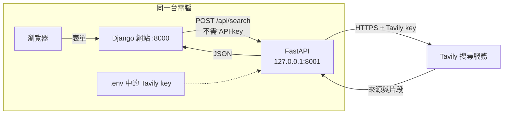

# webfetchapi

以 **FastAPI + HTTPX** 建立的本機網路搜尋服務。填入 **Tavily 搜尋 API key** 後，即可讓同一台電腦上的 Django、Python 或其他後端程式透過 HTTP 搜尋網路資料。

- **不需要 Docker、Django、資料庫或模型即可啟動搜尋服務。**
- 呼叫本機 API **不需要 API key**；Tavily key 僅由服務端用於對外搜尋。
- 啟動時固定監聽 **`127.0.0.1`**，連接埠由 `.env` 的 `PORT` 設定。
- `/api/search` 回傳來源標題、網址與內容片段；不下載網頁全文，不呼叫模型。
- 附有可直接執行的 Django 搜尋頁面，以及選用的「搜尋後交給校內 Ollama 整合」功能。



## 安裝前準備

1. 安裝 **Git、Python 3.11 以上**，建議 Python 3.12。Raspberry Pi 請使用 64 位元 Raspberry Pi OS。
2. 從 [Tavily](https://app.tavily.com/) 取得搜尋金鑰，檢查帳號目前的免費額度與用量限制。此範例使用 `basic` 搜尋，不啟用自動升級搜尋深度。
3. 以下指令均在自己的電腦執行。開啟兩個終端機即可分別運作 FastAPI 與 Django。

## Windows PowerShell

```powershell
git clone https://github.com/minhuangyuntech/webfetchapi.git
cd webfetchapi
py -3.12 -m venv .venv
.\.venv\Scripts\python.exe -m pip install -r requirements.txt
Copy-Item .env.example .env
notepad .env
```

若安裝的是其他支援版本，將 `py -3.12` 改成相應版本。使用虛擬環境的 Python 完整路徑即可，無須調整 PowerShell 執行原則或啟用 `Activate.ps1`。

在 `.env` 填入實際金鑰後儲存：

```dotenv
TAVILY_API_KEY=貼上你的Tavily金鑰
PORT=8001
DEMO_MODE=0
```

```powershell
.\.venv\Scripts\python.exe -m webfetchapi
```

保持此終端機運作，瀏覽 [http://127.0.0.1:8001/docs](http://127.0.0.1:8001/docs)。停止服務按 `Ctrl+C`。

## macOS

先安裝 Git 與 Python 3.11 以上，再執行：

```bash
git clone https://github.com/minhuangyuntech/webfetchapi.git
cd webfetchapi
python3 -m venv .venv
.venv/bin/python -m pip install -r requirements.txt
cp .env.example .env
nano .env
```

填入 `TAVILY_API_KEY`，保留 `DEMO_MODE=0`，儲存後啟動：

```bash
.venv/bin/python -m webfetchapi
```

開啟 [http://127.0.0.1:8001/docs](http://127.0.0.1:8001/docs)。Apple Silicon 與 Intel Mac 使用相同指令。

## Raspberry Pi

使用 64 位元 Raspberry Pi OS，並確認 `python3 --version` 至少為 3.11：

```bash
sudo apt update
sudo apt install -y python3 python3-venv git
git clone https://github.com/minhuangyuntech/webfetchapi.git
cd webfetchapi
python3 -m venv .venv
.venv/bin/python -m pip install -r requirements.txt
cp .env.example .env
nano .env
```

填入 `TAVILY_API_KEY`，保留 `DEMO_MODE=0`，儲存後啟動：

```bash
.venv/bin/python -m webfetchapi
```

FastAPI 與呼叫它的 Django 都應在**同一台 Pi** 上執行；不需在路由器或防火牆開放 FastAPI 連接埠。可在 Pi 本身的終端機測試：

```bash
curl http://127.0.0.1:8001/healthz
```

## 送出第一筆搜尋

`POST /api/search` 的 JSON：

```json
{"query": "Raspberry Pi 5 適合哪些用途？", "max_results": 3}
```

Windows PowerShell，另開一個終端機：

```powershell
$body = @{ query = 'Raspberry Pi 5 適合哪些用途？'; max_results = 3 } | ConvertTo-Json
$bytes = [System.Text.Encoding]::UTF8.GetBytes($body)
Invoke-RestMethod -Uri 'http://127.0.0.1:8001/api/search' -Method Post `
  -ContentType 'application/json; charset=utf-8' -Body $bytes |
  ConvertTo-Json -Depth 8
```

macOS / Raspberry Pi：

```bash
curl http://127.0.0.1:8001/api/search \
  -H 'Content-Type: application/json' \
  -d '{"query":"Raspberry Pi 5 適合哪些用途？","max_results":3}'
```

這兩種呼叫都**不傳送 `Authorization` 或 `X-API-Key`**。亦可在 `/docs` 展開 `POST /api/search`，按 **Try it out → Execute**。

## 從 Django 呼叫

Django 的 view 在後端執行下列程式即可；Django 環境需安裝 `httpx`：

```python
import httpx

with httpx.Client(timeout=30, trust_env=False) as client:
    response = client.post(
        'http://127.0.0.1:8001/api/search',
        json={'query': 'Raspberry Pi 5 適合哪些用途？', 'max_results': 3},
    )
    response.raise_for_status()
    sources = response.json()['sources']
```

完整的表單、view、template 與錯誤處理位於 [`examples/django_site`](examples/django_site)，三種系統的執行指令見 [Django 串接說明](docs/django.md)。這個示範頁面不需要資料庫遷移。

呼叫流程是 **瀏覽器 → Django → FastAPI**。不要在前端 JavaScript 直接跨連接埠呼叫 FastAPI；本服務會拒絕不同來源的瀏覽器請求。Django 與 FastAPI 須在同一作業系統／網路環境執行，例如都在 Windows 或都在同一個 WSL 環境。

## `.env` 設定與連接埠

| 變數 | 預設 | 用途 |
|---|---|---|
| `TAVILY_API_KEY` | 空白 | 真實搜尋必填；只傳送給 Tavily |
| `PORT` | `8001` | 本機 FastAPI 連接埠，範圍 `1024–65535` |
| `DEMO_MODE` | `0` | `1` 使用固定示範資料，不連外、不需要金鑰 |
| `OLLAMA_GATEWAY_URL` | `http://140.125.35.48:9999` | 選用：校內 Pi gateway |
| `OLLAMA_GATEWAY_API_KEY` | 空白 | 選用：服務呼叫 Pi 使用的金鑰 |
| `OLLAMA_MODEL` | 空白 | 選用：模型預設名稱，也可在請求指定 |

例如改用 `PORT=8101`，重新啟動後網址就是 `http://127.0.0.1:8101`；Django 的 `WEBFETCHAPI_URL` 也必須相應修改。不同電腦可使用相同連接埠，**同一台電腦上的服務**才需避免占用相同連接埠。

程式會自動讀取 repo 根目錄的 `.env`，已存在的系統／終端機環境變數優先。修改 `.env` 後須重新啟動；`.env` 已加入 `.gitignore`，請勿將真實金鑰寫入程式或提交到 Git。

若暫時沒有搜尋金鑰，將 `.env` 改成 `DEMO_MODE=1`。回應中的 `mode` 和網頁會明確標示 `demo`；改回 `0` 並填入金鑰，才會取得真實網路結果。

## 本機限制的實作

請使用 `python -m webfetchapi` 啟動。這個入口固定設定 `host='127.0.0.1'`，不提供 `HOST=0.0.0.0` 選項，並關閉代理來源標頭處理。

中介層再檢查連線來源是否為 loopback、`Host` 是否為本機名稱，以及瀏覽器的 `Origin`；搜尋請求必須使用 JSON。不同電腦不能以本機的區網 IP 連上此服務。這是**以電腦為範圍**的限制，同一台電腦上的其他程式或帳號仍可呼叫。

不應再以反向代理、對外轉送或修改啟動參數的方式公開這個無呼叫端認證的服務。FastAPI 不提供 CORS 開放設定，Django 後端的 HTTP 呼叫不受瀏覽器 CORS 限制。

## API、程式與測試

- [API 規格與錯誤處理](docs/api.md)
- [Django 串接、非同步寫法與執行指令](docs/django.md)
- [選用：透過校內 Ollama 整合搜尋資料](docs/optional-model.md)
- [設計與檔案關係](docs/design.md)

```text
webfetchapi/
├── .env.example
├── requirements.txt
├── webfetchapi/          # 可獨立啟動的 FastAPI
├── examples/django_site/ # 選用的 Django 網頁範例
├── docs/                # API 與整合說明
└── tests/               # 不需真實金鑰的自動測試
```

在 repo 根目錄執行自動測試；不使用真實搜尋額度：

```powershell
# Windows PowerShell
.\.venv\Scripts\python.exe -m unittest discover -s tests -v
```

```bash
# macOS / Raspberry Pi
.venv/bin/python -m unittest discover -s tests -v
```

`/healthz` 只代表程式成功啟動，不代表 Tavily 額度、網路或選用的 Pi 模型服務已通過實際驗證。若遇到連接埠占用，修改 `.env` 的 `PORT`；若搜尋回報 `502/503/504`，依 [錯誤說明](docs/api.md#錯誤回應) 檢查金鑰、額度與網路。

官方參考：[FastAPI](https://fastapi.tiangolo.com/)、[Uvicorn 設定](https://uvicorn.dev/settings/)、[Tavily Search API](https://docs.tavily.com/documentation/api-reference/endpoint/search)、[HTTPX](https://www.python-httpx.org/)。
