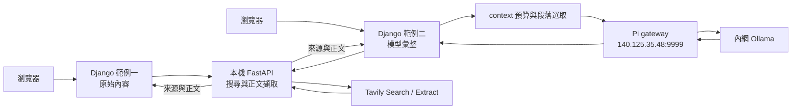

# webfetchapi

提供上層網站使用的 **本機網路內容搜尋 API**。FastAPI 依關鍵字呼叫 Tavily 搜尋並擷取網頁正文，將資料回傳給 Django 或其他後端程式。

**搜尋服務不呼叫大語言模型，也不持有模型金鑰。** 模型彙整由上層 Django 網站實作。

| 元件 | 工作 | 預設網址 |
|---|---|---|
| FastAPI `webfetchapi` | 搜尋、擷取正文、回傳 JSON | `http://127.0.0.1:8001` |
| Django 範例一 `examples/django_site` | 輸入關鍵字，如實呈現搜尋片段、正文與來源 | `http://127.0.0.1:8000` |
| Django 範例二 `examples/django_summary_site` | 搜尋後計算 context 預算，再呼叫 Pi gateway 進行模型彙整 | `http://127.0.0.1:8002` |



FastAPI 固定監聽 `127.0.0.1`，呼叫時**不需 API key**。它只有向 Tavily 搜尋／擷取時才使用 Tavily key。Django 範例二另外持有 Pi 的 key，不會將它傳給搜尋服務或瀏覽器。

## 安裝搜尋服務

需要 Git、Python 3.11 以上，建議 Python 3.12；不需要 Docker、Django、資料庫或模型。從 [Tavily 後台](https://app.tavily.com/) 取得金鑰並確認額度。正文擷取使用獨立的 Extract API，會依其規則使用額度。

### Windows PowerShell

```powershell
git clone https://github.com/minhuangyuntech/webfetchapi.git
cd webfetchapi
py -3.12 -m venv .venv
.\.venv\Scripts\python.exe -m pip install -r requirements.txt
Copy-Item .env.example .env
notepad .env
```

若使用其他支援版本，調整 `py -3.12`。不必啟用 `Activate.ps1` 或修改 PowerShell 執行原則。填入 `.env`：

```dotenv
TAVILY_API_KEY=你的Tavily金鑰
PORT=8001
DEMO_MODE=0
```

啟動並保持終端機運作：

```powershell
.\.venv\Scripts\python.exe -m webfetchapi
```

### macOS

先安裝 Git 與 Python 3.11 以上：

```bash
git clone https://github.com/minhuangyuntech/webfetchapi.git
cd webfetchapi
python3 -m venv .venv
.venv/bin/python -m pip install -r requirements.txt
cp .env.example .env
nano .env
.venv/bin/python -m webfetchapi
```

在編輯器填入 `TAVILY_API_KEY`，儲存後再執行最後一行。Apple Silicon 與 Intel Mac 使用相同指令。

### Raspberry Pi

使用 64 位元 Raspberry Pi OS，確認 `python3 --version` 至少為 3.11：

```bash
sudo apt update
sudo apt install -y python3 python3-venv git
git clone https://github.com/minhuangyuntech/webfetchapi.git
cd webfetchapi
python3 -m venv .venv
.venv/bin/python -m pip install -r requirements.txt
cp .env.example .env
nano .env
.venv/bin/python -m webfetchapi
```

填妥金鑰再啟動。呼叫此 FastAPI 的 Django 也必須在同一台 Pi 的同一網路環境中執行。不需要開放 FastAPI 的區網連接埠。

三種系統啟動後皆可在同機開啟 [API 文件](http://127.0.0.1:8001/docs)。按 `Ctrl+C` 停止。無金鑰時可先用 `DEMO_MODE=1`，會回傳標示 DEMO 的固定片段與正文，不連外。

## 呼叫 API

`POST /api/search`：

```json
{"query":"Raspberry Pi 5 用途","max_results":3,"include_body":true}
```

`include_body` 預設 `true`，取得搜尋片段後再擷取正文。設為 `false` 只取得片段。回應中的 `content` 是片段，`body_text` 是正文；`extraction_status` 與 `body_truncated` 說明擷取結果及長度限制，不保證所有網站都能取得完整正文。

Windows PowerShell：

```powershell
$body = @{ query = 'Raspberry Pi 5 用途'; max_results = 3; include_body = $true } | ConvertTo-Json
$bytes = [System.Text.Encoding]::UTF8.GetBytes($body)
Invoke-RestMethod -Uri 'http://127.0.0.1:8001/api/search' -Method Post `
  -ContentType 'application/json; charset=utf-8' -Body $bytes |
  ConvertTo-Json -Depth 8
```

macOS / Raspberry Pi：

```bash
curl http://127.0.0.1:8001/api/search \
  -H 'Content-Type: application/json' \
  -d '{"query":"Raspberry Pi 5 用途","max_results":3,"include_body":true}'
```

呼叫端不傳 `Authorization` 或 `X-API-Key`。Django 應由後端發出 HTTP 請求；不同連接埠的瀏覽器 JavaScript 請求會被本機來源檢查拒絕。

## 兩個 Django 範例

[完整安裝與操作說明](docs/django.md) 提供 PowerShell、macOS、Raspberry Pi 指令。兩個範例可各自獨立啟動，不互相匯入程式碼，也不需要資料庫遷移。

- **範例一**：只呼叫搜尋 API，原樣顯示回傳片段與正文，保留換行並啟用 HTML escaping。沒有模型連線、提示詞或模型金鑰。
- **範例二**：由 Django 分別呼叫搜尋 API 與 Pi gateway；先取得模型資訊，計算 context 預算、選取段落，再傳給模型。頁面呈現回答、預算、實際送入的段落與原始來源。模型失敗時仍保留搜尋結果。

context 處理在第二個 Django 範例內；[預算原理與限制](docs/context-budget.md) 說明模型上限、輸出預留、估算與精確 token 計數的差異。

## `.env` 與連接埠

| 檔案 | 主要設定 | 金鑰 |
|---|---|---|
| repo 根目錄 `.env` | `PORT=8001`、`DEMO_MODE` | `TAVILY_API_KEY` |
| `examples/django_site/.env` | `DJANGO_PORT=8000`、`WEBFETCHAPI_URL` | 無 |
| `examples/django_summary_site/.env` | `DJANGO_PORT=8002`、`WEBFETCHAPI_URL`、模型與 context 設定 | `OLLAMA_GATEWAY_API_KEY` |

三個程式各自讀取自己的 `.env`，終端機環境變數優先。修改後重啟對應程式。FastAPI 若改成 `PORT=8101`，兩個 Django 的 `WEBFETCHAPI_URL` 都須改為 `http://127.0.0.1:8101`。

同一電腦的服務需使用不同連接埠；不同電腦可用相同連接埠。`.env` 已被 Git 忽略，請勿提交實際金鑰。

## 本機限制與服務狀態

請用 `python -m webfetchapi` 啟動：入口固定綁定 `127.0.0.1`、停用代理來源標頭，middleware 再檢查連線來源、Host、瀏覽器 Origin 與 JSON Content-Type。這是以電腦為範圍的限制，同機其他程式仍可呼叫。不要以反向代理或轉送方式將這個無呼叫端認證的服務公開。

`GET /healthz` 只代表搜尋程式已啟動，沒有驗證 Tavily 金鑰、額度或網路。Windows 與 WSL、Docker 容器彼此的 `127.0.0.1` 不一定是同一網路環境；本範例採同一環境原生執行。

## 程式與驗證

```text
webfetchapi/                         # 純搜尋與正文擷取服務
examples/django_site/                # 範例一：原始內容
examples/django_summary_site/        # 範例二：context + 模型
docs/api.md                         # 回應欄位與錯誤
docs/django.md                      # 三種系統操作
docs/context-budget.md              # context 預算
docs/design.md                      # 檔案關係與服務分工
tests/                              # 搜尋服務測試
```

安裝對應範例的 requirements 後，在 repo 根目錄測試：

```powershell
# Windows PowerShell
.\.venv\Scripts\python.exe -m unittest discover -s tests -v
.\.venv\Scripts\python.exe examples/django_site/manage.py test searchdemo
.\.venv\Scripts\python.exe examples/django_summary_site/manage.py test summarydemo
```

```bash
# macOS / Raspberry Pi
.venv/bin/python -m unittest discover -s tests -v
.venv/bin/python examples/django_site/manage.py test searchdemo
.venv/bin/python examples/django_summary_site/manage.py test summarydemo
```

測試使用模擬上游回應，不消耗搜尋額度或呼叫真實模型。

## 從 v1 更新

v2 移除 FastAPI 的 `/api/models`、`/api/research` 與模型相關設定；它們不再是搜尋服務的責任。將模型設定移到第二個 Django 範例自己的 `.env`。`/api/search` 保留 `content` 片段欄位，新增正文與狀態欄位；預設會執行正文擷取，若要保留原本只搜尋的行為，請指定 `include_body=false`。時間欄位改為搜尋與擷取時間，不再包含模型時間。

參考：[Tavily Search](https://docs.tavily.com/documentation/api-reference/endpoint/search)、[Tavily Extract](https://docs.tavily.com/documentation/api-reference/endpoint/extract)、[Ollama Chat](https://docs.ollama.com/api/chat)。
