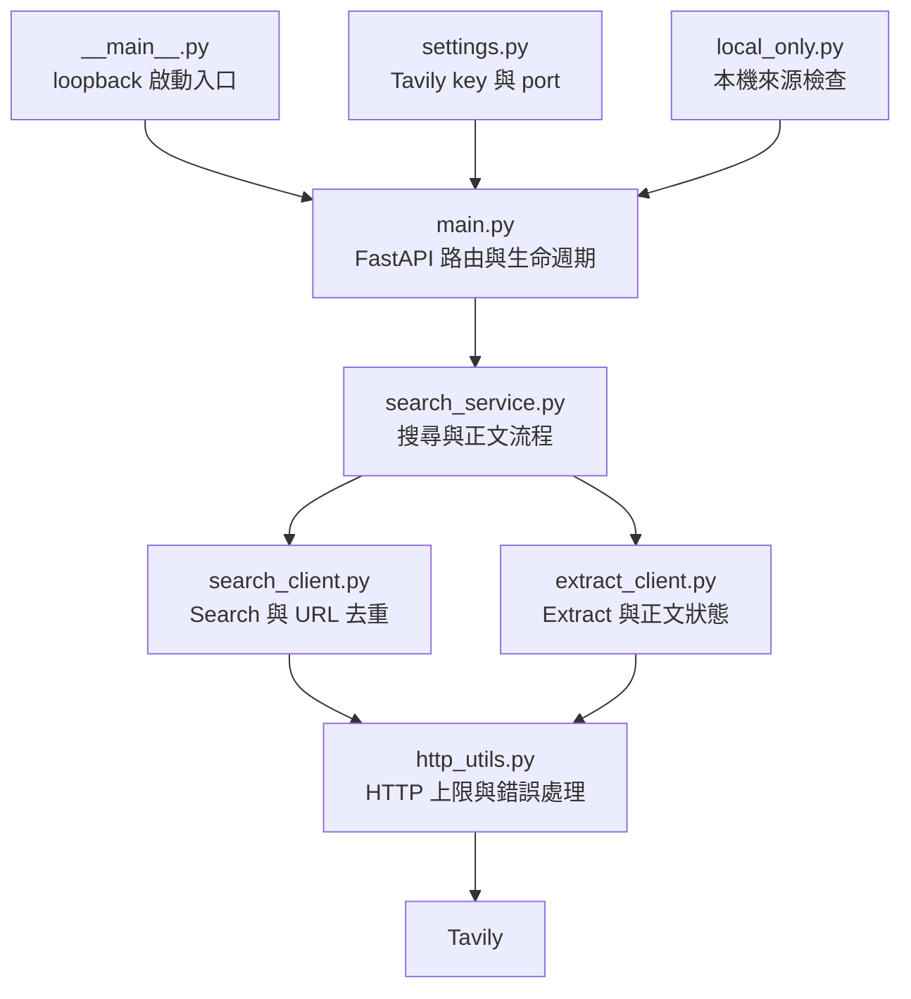
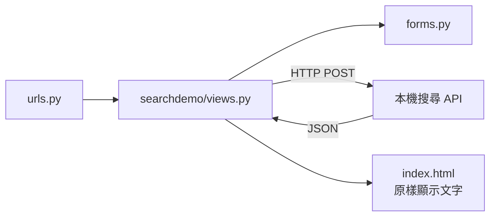
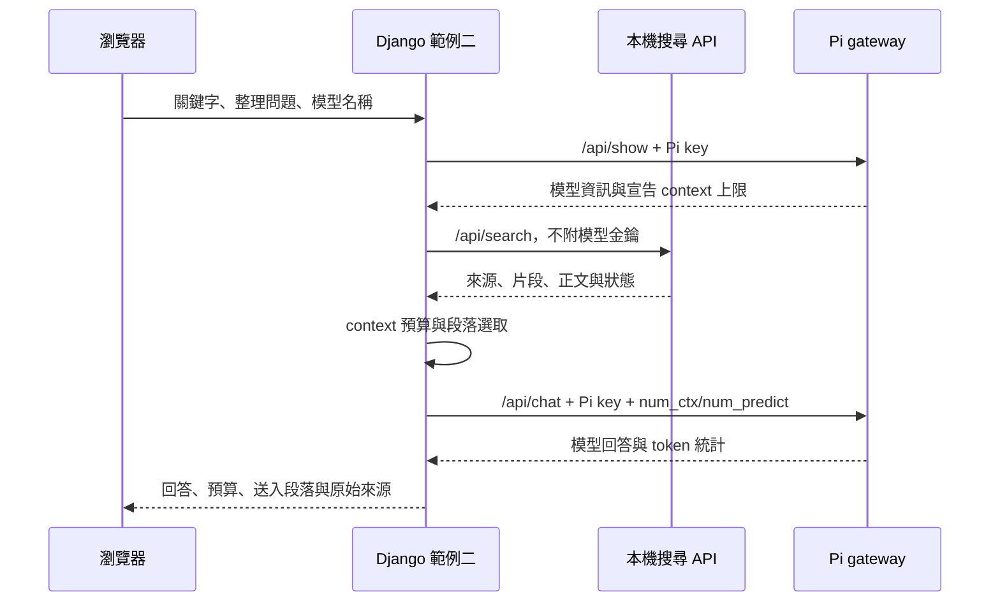

# 分工與檔案關係

## 搜尋服務

`schemas.py` 定義請求與回應。`demo.py` 提供固定的片段與正文。FastAPI 使用 lifespan 共用 HTTPX AsyncClient，非同步等待 Search、Extract；單 worker 的執行名額涵蓋整個搜尋／擷取流程，失敗時在 `finally` 釋放。

只透過已設定的 Tavily 端點取得內容，程式不直接下載搜尋結果的任意 URL。未提供 Extract 的 `query` 或 `chunks_per_source`，避免把相關片段回應誤認成正文。批次擷取回應按正規化 URL 對應到來源，不能用陣列位置配對。

網址去重限於單次請求；它不是內容去重，也不是跨搜尋快取。文章正文保留供上層自行處理，不執行語意合併或模型改寫。若上層需要對話、歷史或快取，可由 Django 保存查詢、來源及擷取結果。

## Django 範例一

表單決定是否擷取正文。view 負責呼叫 API、檢查資料與錯誤；template 顯示來源、片段、正文與擷取狀態。沒有模型相關程式。

## Django 範例二

| 檔案 | 工作 |
|---|---|
| `summarydemo/forms.py` | 輸入欄位驗證 |
| `summarydemo/views.py` | 協調模型資訊、搜尋、預算及彙整，保留失敗時的來源 |
| `summarydemo/services.py` | HTTP 介面，Pi key 僅附在 Pi 請求 |
| `summarydemo/context_budget.py` | 完整訊息估算、段落相關性與容量選取 |
| `summarydemo/templates/summarydemo/index.html` | 模型回答、輸入容量與來源呈現 |
| `list_models.py` | 依網站 `.env` 查詢 Pi 已安裝模型 |

兩個 Django 專案分開使用自己的 settings 與 `.env`，不互相 import，也不 import FastAPI 的 Python package。它們可以使用各自的 venv；操作文件為方便練習共用同一個 venv，但仍是獨立行程與 HTTP 服務。
