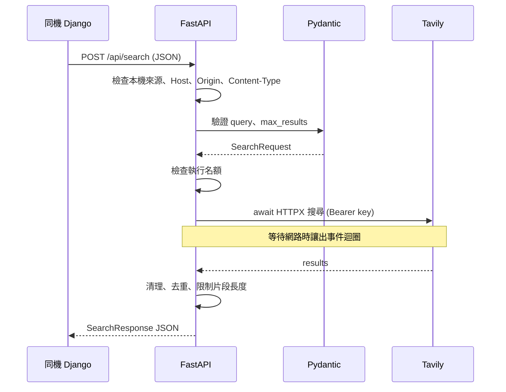

# 設計與檔案關係

## 執行流程



Tavily key 只存在服務端設定與對外 HTTP 標頭中，不是輸入表單欄位，也不需要傳到 Django 或瀏覽器。獨立服務不儲存對話或搜尋歷史；若網站需要歷史查詢，可在 Django 收到回應後自行存入網站資料庫。

## 程式檔案

| 檔案 | 負責工作 |
|---|---|
| `webfetchapi/__main__.py` | `python -m webfetchapi` 入口，固定 loopback、單一 worker、停用代理來源標頭 |
| `webfetchapi/settings.py` | 讀取 repo 根目錄 `.env`，驗證連接埠與必要設定 |
| `webfetchapi/main.py` | 路由、生命週期、共用 AsyncClient、錯誤回應與執行名額 |
| `webfetchapi/local_only.py` | 本機來源、Host、瀏覽器 Origin、JSON 格式限制 |
| `webfetchapi/schemas.py` | Pydantic 請求與回應模型 |
| `webfetchapi/search_service.py` | 純搜尋流程及 DEMO 分支 |
| `webfetchapi/search_client.py` | 呼叫 Tavily、來源網址清理、去重、片段長度限制 |
| `webfetchapi/http_utils.py` | HTTP 回應大小限制、JSON 解析、逾時與上游錯誤轉換 |
| `webfetchapi/research_service.py` | 選用的模型確認、搜尋、整理與引用編號檢查 |
| `webfetchapi/ollama_client.py` | 選用的 Pi gateway 模型清單與聊天 API |
| `webfetchapi/prompts.py` | 選用的整理提示詞，分開指令與來源資料 |
| `webfetchapi/demo.py` | 固定離線示範資料 |
| `webfetchapi/errors.py` | 可對呼叫端呈現的服務錯誤類別 |

## 非同步處理

FastAPI 啟動時透過 lifespan 建立一個 `httpx.AsyncClient`，關閉時釋放它。不同請求共用連線池，避免每次搜尋重新建立 client；`trust_env=False` 避免繼承系統代理設定干擾本機／校內連線。

```python
async def search(payload: SearchRequest, request: Request):
    return await limited(request.app.state, search_only, payload)
```

路由接收 Pydantic 已驗證的資料後進入 `search_only()`。連外的 `await` 讓事件迴圈可以處理其他請求；結果回來後繼續清理資料。純文字清理與 JSON 解析仍是同步工作，所以限制上游回應大小與片段長度。

搜尋與研究共用最多 4 個執行名額。名額檢查與加一之間沒有 `await`，在目前單 worker、單事件迴圈的設定下可避免交錯；`finally` 確保成功或失敗都釋放名額。若未來改為多 worker，這個計數只會是各行程自己的計數，必須重新設計全域流量限制。

## 為何使用固定本機位址

`127.0.0.1` 指向執行服務的電腦，不會公開到區域網路。本專案同時在啟動入口固定 socket 綁定位址、在 ASGI middleware 檢查來源；`X-Forwarded-For` 不會被用來取代真實連線來源。

瀏覽器的跨來源請求也要另外檢查：不同網站可能試著呼叫使用者電腦上的服務。因此只允許相同 `Origin` 的瀏覽器請求；不同連接埠的 Django 頁面應交由 Django 後端呼叫。Swagger `/docs` 與 API 同來源，可直接測試。

這些設定以一般本機開發為使用情境；不隔離同機的不同登入帳號，也不應當作可對外公開服務的身分認證方案。
