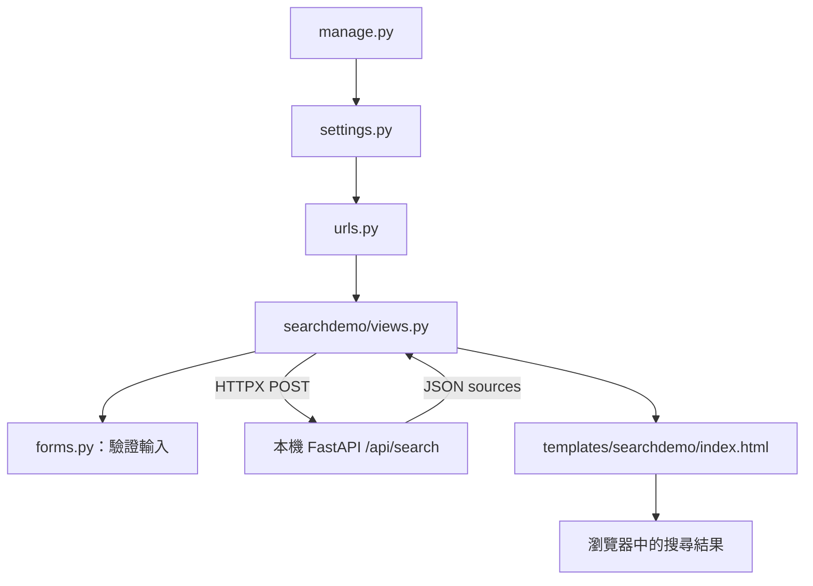

# Django 串接與完整範例

先依 [README](../README.md) 啟動 FastAPI，保持第一個終端機運作。以下在**第二個終端機、repo 根目錄**執行。可先用 `DEMO_MODE=1` 驗證整個網站流程。

## 執行內附網站

Windows PowerShell：

```powershell
.\.venv\Scripts\python.exe -m pip install -r examples/django_site/requirements.txt
$env:WEBFETCHAPI_URL = 'http://127.0.0.1:8001'
.\.venv\Scripts\python.exe examples/django_site/manage.py runserver 127.0.0.1:8000
```

macOS / Raspberry Pi：

```bash
.venv/bin/python -m pip install -r examples/django_site/requirements.txt
export WEBFETCHAPI_URL=http://127.0.0.1:8001
.venv/bin/python examples/django_site/manage.py runserver 127.0.0.1:8000
```

在**執行 Django 的電腦**開啟 [http://127.0.0.1:8000](http://127.0.0.1:8000)，輸入對象或問題，送出後就能查看搜尋片段。這個最小範例沒有資料表、登入或歷史記錄，因此不需要 `migrate`。

若 FastAPI 的 `.env` 設為 `PORT=8101`，此處的 `WEBFETCHAPI_URL` 要改成 `http://127.0.0.1:8101`。若 Django 的 8000 已占用，可將 `runserver` 後面改成 `127.0.0.1:8100`。根目錄 `.env` 由 FastAPI 讀取；此 Django 範例的 `WEBFETCHAPI_URL` 透過終端機環境變數設定。

範例的 `DEBUG=True` 與預設 `SECRET_KEY` 僅供本機開發。若整合到既有 Django 專案，沿用該專案的正式設定。`runserver` 用於本機開發測試。

## 放進自己的 Django 專案

在自己的 Django 虛擬環境安裝 `httpx`，並在 `settings.py` 設定：

```python
import os
WEBFETCHAPI_URL = os.environ.get('WEBFETCHAPI_URL', 'http://127.0.0.1:8001').rstrip('/')
```

在 view 中用已驗證的表單欄位組成 JSON：

```python
import httpx
from django.conf import settings

def search_web(query, max_results=5):
    with httpx.Client(timeout=30, trust_env=False) as client:
        response = client.post(
            f'{settings.WEBFETCHAPI_URL}/api/search',
            json={'query': query, 'max_results': max_results},
        )
        response.raise_for_status()
        return response.json()
```

不需要在 Django 放入 Tavily key 或 `X-API-Key`。若介面有「搜尋對象」與「想瞭解的問題」兩個欄位，可將驗證後的文字以空格組合為 `query`，總長度需在 720 字元內。

完整錯誤處理見 [`searchdemo/views.py`](../examples/django_site/searchdemo/views.py)：

- 表單驗證錯誤：在頁面顯示欄位訊息，不送出 API 請求。
- `TimeoutException`：提示稍後重試。
- `HTTPStatusError`：顯示狀態碼，依 FastAPI 文件檢查設定。
- `RequestError`：提示確認 FastAPI 是否啟動及連接埠是否一致。

template 保留 Django 預設 HTML escaping，不對網路文字使用 `safe`。外部網頁內容仍可能有錯誤或夾帶指令；若要交給模型，應將它視為待分析資料，並保留來源供查核。

## Python 非同步寫法

若自己的 Django view 是 `async def`，呼叫外部 HTTP 時可使用 `httpx.AsyncClient`：

```python
import httpx
from django.conf import settings
from django.http import JsonResponse
from django.views.decorators.http import require_GET

@require_GET
async def search_json(request):
    query = request.GET.get('q', '').strip()
    if not 1 <= len(query) <= 720:
        return JsonResponse({'error': '搜尋字詞須為 1–720 字元。'}, status=400)
    try:
        async with httpx.AsyncClient(timeout=30, trust_env=False) as client:
            response = await client.post(
                f'{settings.WEBFETCHAPI_URL}/api/search',
                json={'query': query, 'max_results': 5},
            )
            response.raise_for_status()
            return JsonResponse(response.json())
    except httpx.HTTPError:
        return JsonResponse({'error': '搜尋服務暫時無法使用。'}, status=502)
```

`await` 在等待網路回應時讓出事件迴圈，使其他協程有機會執行。它不會使單次搜尋本身變快。此範例的 `JsonResponse` 接收的是已解析的 JSON；`response.json()` 是同步解析，不需 `await`。

Django 在 ASGI 下搭配非同步相容的 middleware，才能完整利用非同步請求處理；單純把 `def` 改為 `async def` 不代表整個網站已具備此能力。內附網站先使用容易整合的同步 view，FastAPI 內部仍採用非同步 HTTPX 連外。

## 檔案關係



## 驗證範例網站

安裝網站套件後，在 repo 根目錄執行：

```powershell
# Windows PowerShell
.\.venv\Scripts\python.exe examples/django_site/manage.py check
.\.venv\Scripts\python.exe examples/django_site/manage.py test searchdemo
```

```bash
# macOS / Raspberry Pi
.venv/bin/python examples/django_site/manage.py check
.venv/bin/python examples/django_site/manage.py test searchdemo
```

測試以模擬 HTTP 回應確認表單、CSRF、後端呼叫與 HTML escaping，不會消耗搜尋額度。

參考：[Django 非同步支援](https://docs.djangoproject.com/en/5.2/topics/async/)、[HTTPX 非同步用法](https://www.python-httpx.org/async/)。
