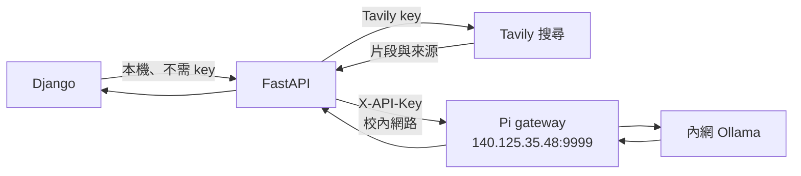

# 選用：搜尋後由校內 Ollama 整合

純網路搜尋只使用 `/api/search`，填入 Tavily key 就能運作。若還希望保留原範例「搜尋 → 本地模型整理」的流程，可以啟用 `/api/models` 與 `/api/research`。

## 設定

在 `.env` 中設定以下欄位，再重新啟動 FastAPI：

```dotenv
TAVILY_API_KEY=你的Tavily金鑰
PORT=8001
DEMO_MODE=0
OLLAMA_GATEWAY_URL=http://140.125.35.48:9999
OLLAMA_GATEWAY_API_KEY=可使用校內Pi的金鑰
OLLAMA_MODEL=
```

`OLLAMA_GATEWAY_API_KEY` 用於 **FastAPI → Pi gateway**，與本機 API 的呼叫端認證無關。Django 呼叫本機 FastAPI 仍不需 API key。需處於 Pi gateway 允許的網路範圍且能連上該主機；此 repo 不部署或修改 Pi gateway。



## 先查模型，再發送研究請求

Windows PowerShell：

```powershell
Invoke-RestMethod 'http://127.0.0.1:8001/api/models'
```

macOS / Raspberry Pi：

```bash
curl http://127.0.0.1:8001/api/models
```

回應的 `models` 為可用模型名稱。可將其中一個填入 `.env` 的 `OLLAMA_MODEL`，或在每次請求指定 `model`。以下 Python 程式會取清單中的第一個模型；可自行改成介面選擇：

```python
import httpx

with httpx.Client(base_url='http://127.0.0.1:8001', timeout=360, trust_env=False) as client:
    response = client.get('/api/models')
    response.raise_for_status()
    models = response.json()['models']
    if not models:
        raise RuntimeError('目前沒有可用模型。')
    response = client.post('/api/research', json={
        'target': 'Raspberry Pi 5',
        'question': '適合哪些用途？請整理優點與限制。',
        'max_results': 5,
        'model': models[0],
    })
    response.raise_for_status()
    result = response.json()
    print(result['status'])
    print(result['answer'])
    for source in result['sources']:
        print(source['id'], source['title'], source['url'])
```

## 輸入與回應

| 輸入欄位 | 限制 |
|---|---|
| `target` | 去除頭尾空白後 1–120 字元，必填 |
| `question` | 去除頭尾空白後 1–600 字元，必填 |
| `max_results` | 整數 1–8，預設 5 |
| `model` | 最多 160 字元；空白時採用 `.env` 的 `OLLAMA_MODEL` |

服務先向 Pi 取得模型清單，確認模型有效後才進行搜尋，避免因選錯模型消耗搜尋額度。搜尋字詞是 `target` 和 `question` 以空格組合。

回應包含 `answer`、`sources`、`citations`、`warnings`、`model`、`mode`、`timings`、`collected_at` 與 `query`。`status` 有三種：

- `ok`：完成搜尋與模型回答。
- `no_results`：沒有可用片段，因此不進行模型推論。
- `partial`：搜尋完成，但模型生成失敗；仍以 HTTP 200 回傳已取得的來源與說明。

模型清單連線失敗或模型名稱無效發生在搜尋之前，會直接回傳非 200 狀態。未設定 Pi key 時，兩個選用端點回傳 `503 model_not_configured`，不影響 `/api/search`。

此流程使用 Ollama `stream=false`，等待完整回答後回傳 JSON，不是 NDJSON 串流。模型提示詞將搜尋片段放在獨立資料區段，要求引用 `[1]`、`[2]` 等來源；程式檢查引用編號是否存在，但不等於驗證內容真偽，也無法保證完全避免提示注入。

`DEMO_MODE=1` 時，這兩個端點也可不連外執行，回傳 `demo-model` 與明確標示 DEMO 的固定資料。
